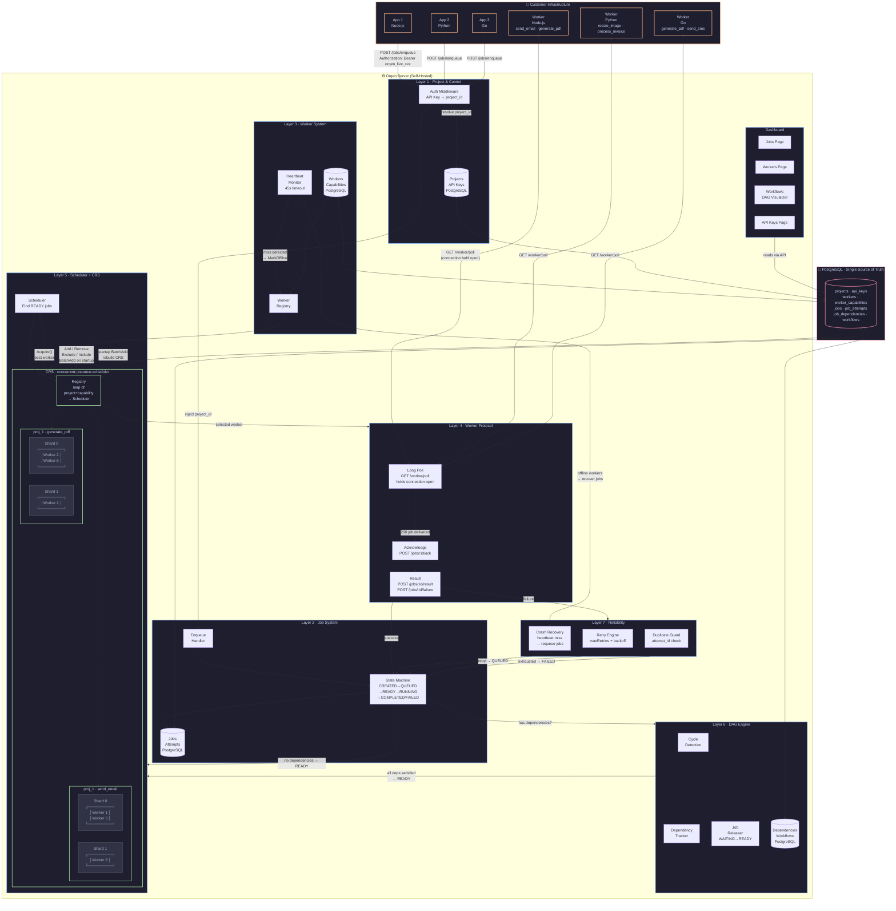
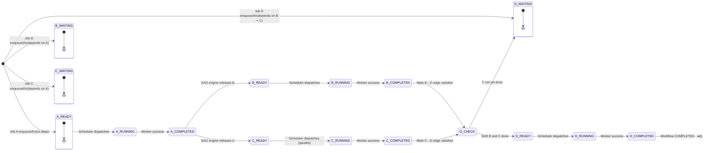
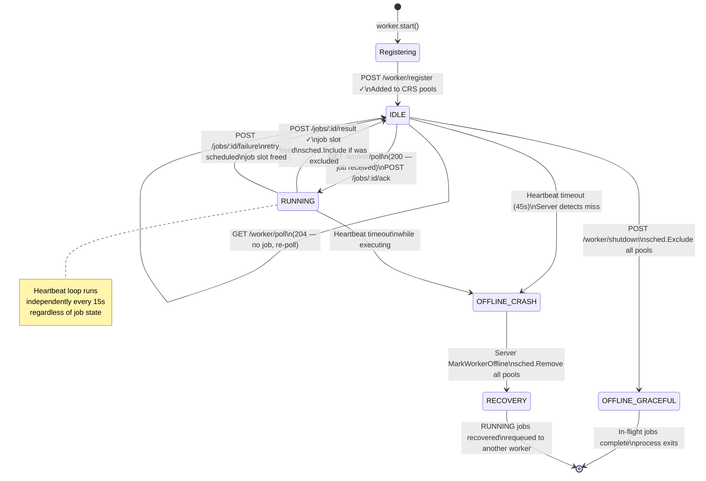

# Orqen

<div align="center">

**Self-hosted · Language-independent · Durable · Multi-project**

*A job processing and workflow platform built for engineering teams who need more than a queue.*

---

Orqen gives your team one place to run background jobs across every application you own — regardless of what language they're written in. Deploy it once on your own infrastructure. Create isolated projects for each app. Connect workers in Node.js, Python, Go, or anything that speaks HTTP. Define complex multi-step workflows with dependencies. Watch everything through a built-in dashboard. Sleep easy knowing PostgreSQL has your jobs even if the server crashes.

No Redis. No lock-in. No separate orchestration tool. Just durable, observable, dependency-aware job processing.

</div>

---

## What Is Orqen?

Orqen is a self-hosted job processing and workflow platform. Deploy one instance. Run background jobs across multiple independent applications. Workers can be written in any language. Jobs survive crashes. Workflows handle complex dependencies. Everything is observable through a built-in dashboard.

```
Your App (Node.js)  ──┐
Your App (Python)   ──┤
Your App (Go)       ──┤──► Orqen ──► Workers ──► Your Functions
Your App (Java)     ──┤
Your App (...)      ──┘
```

---

## Why Orqen?

| Problem | Orqen's Answer |
|---|---|
| BullMQ only works with Node.js | Workers connect over HTTP — any language works |
| Running separate queues per app is expensive | One deployment, multiple isolated projects |
| Redis queues lose jobs on crash | PostgreSQL-backed — jobs survive anything |
| No way to express "run B after A" | First-class DAG dependency engine |
| Need Airflow just for a simple workflow | Built-in DAG support, no extra tools |

---

## The Big Picture



---

## DAG Execution Flow



---

## CRS Worker Selection — Deep Dive

```mermaid
flowchart LR
    subgraph TRIGGER["Scheduling Trigger"]
        JOB["READY Job\ntype: generate_pdf\nproject: proj_1"]
    end

    subgraph REGISTRY["CRS Registry\nmap of project+capability → Scheduler"]
        direction TB
        KEY["Key lookup\n(proj_1, generate_pdf)"]
    end

    subgraph INSTANCE["CRS Scheduler Instance\nHeapCount: 8  ·  Policy: Exclusive"]
        direction TB

        STRATEGY["AcquireStrategy\n(Round Robin default)"]

        subgraph SHARDS["8 Independent Shards — each with its own lock"]
            SH0["Shard 0\nWorker2 ⬆ free:8\nWorker5 · free:3"]
            SH1["Shard 1\nWorker1 · free:6"]
            SH2["Shard 2\n(empty)"]
            SH3["...Shards 3-7"]
        end

        LOOKUP["O(1) Lookup Map\nworker_id → HeapNode\n(sync.RWMutex)"]

        STRATEGY -->|"select shard 0"| SH0
    end

    subgraph RESULT["Acquisition Result"]
        POPPED["Worker2 popped\nfrom Shard 0 heap\n(moved to Inactive Store)"]
        CHECK{"CurrentJobCount\n< Concurrency?"}
        INCL["sched.Include(Worker2)\nreturns to heap"]
        EXCL["Worker2 stays excluded\nall capability pools"]
    end

    subgraph DISPATCH["Dispatch"]
        DELIVER["Job delivered\nvia long-poll response\nto Worker2"]
    end

    JOB --> KEY
    KEY --> INSTANCE
    INSTANCE --> POPPED
    POPPED --> CHECK
    CHECK -->|"YES — slots remain"| INCL
    CHECK -->|"NO — at capacity"| EXCL
    INCL --> DELIVER
    EXCL --> DELIVER

    style INSTANCE fill:#1a1a2e,stroke:#a6e3a1,color:#cdd6f4
    style SHARDS fill:#16213e,stroke:#6c7086,color:#a6adc8
    style REGISTRY fill:#1a1a2e,stroke:#89b4fa,color:#cdd6f4
    style TRIGGER fill:#1a1a2e,stroke:#fab387,color:#cdd6f4
    style RESULT fill:#1a1a2e,stroke:#f38ba8,color:#cdd6f4
    style DISPATCH fill:#1a1a2e,stroke:#a6e3a1,color:#cdd6f4
```



---

## Worker Lifecycle



---


## Project Status

> **🚧 Pre-Implementation — Specification Complete**

Orqen is currently in the pre-implementation phase. The full product specification, architecture, data model, API contracts, SDK spec, and contributor documentation are complete. Active development begins **October 2026**. No production code exists yet — that's intentional.

If you're here early, the best thing you can do is **read the spec, open issues with feedback, and watch this repo** so you're notified the moment the first code drops. Early contributors who understand the architecture will have the most impact.

---

## Documentation Index

| # | File | What It Covers |
|---|---|---|
| — | [`ORQEN.md`](./ORQEN.md) | Full product specification (single-file reference) |
| — | [`DECISIONS.md`](./orqen-docs/DECISIONS.md) | Architectural decisions log — read before changing anything core |
| 00 | [`00-INDEX.md`](./orqen-docs/00-INDEX.md) | Agent entry point — reading order and file map |
| 01 | [`01-PROJECT.md`](./orqen-docs/01-PROJECT.md) | Vision, goals, non-goals, V1 scope, customer journey |
| 02 | [`02-REQUIREMENTS.md`](./orqen-docs/02-REQUIREMENTS.md) | All functional, non-functional, and security requirements |
| 03 | [`03-ARCHITECTURE.md`](./orqen-docs/03-ARCHITECTURE.md) | All 7 layers, component responsibilities, end-to-end flow |
| 04 | [`04-DATA-MODEL.md`](./orqen-docs/04-DATA-MODEL.md) | Full PostgreSQL schema — every table, column, index, query |
| 05 | [`05-WORKER-PROTOCOL.md`](./orqen-docs/05-WORKER-PROTOCOL.md) | Long-poll protocol — all operations, request/response shapes |
| 06 | [`06-JOB-SCHEDULING.md`](./orqen-docs/06-JOB-SCHEDULING.md) | Job lifecycle, DAG engine, scheduling flow |
| 07 | [`07-CRS-INTEGRATION.md`](./orqen-docs/07-CRS-INTEGRATION.md) | Every CRS API call, registry design, Comparator, policies |
| 08 | [`08-RELIABILITY.md`](./orqen-docs/08-RELIABILITY.md) | Retries, heartbeat, crash recovery, duplicates, restart |
| 09 | [`09-API-REFERENCE.md`](./orqen-docs/09-API-REFERENCE.md) | All HTTP endpoints — auth, request, response, errors |
| 10 | [`10-SDK-SPEC.md`](./orqen-docs/10-SDK-SPEC.md) | Language-neutral SDK contract and compliance checklist |
| 11 | [`11-PROJECT-ISOLATION.md`](./orqen-docs/11-PROJECT-ISOLATION.md) | Isolation rules, enforcement points, security checklist |
| 12 | [`12-DASHBOARD.md`](./orqen-docs/12-DASHBOARD.md) | Dashboard pages, DAG visualizer, data sources, actions |
| 13 | [`13-DEVELOPER-GUIDE.md`](./orqen-docs/13-DEVELOPER-GUIDE.md) | Prerequisites, setup, repo structure, dev workflow |

---

## Tech Stack

| Component | Technology |
|---|---|
| Backend | Go 1.22+ |
| Database | PostgreSQL 15+ |
| Worker selection | [`concurrent-resource-scheduler`](https://github.com/phero20/concurrent-resource-scheduler) |
| Worker protocol | HTTP long polling |
| SDKs | Node.js · Python · Go |
| Dashboard | Web UI (bundled with server) |

---

## Core Concept in 5 Questions

```
1. What project does this belong to?   →  API Key → project_id
2. What needs to happen?               →  Job (type + payload)
3. Can it run yet?                     →  DAG Engine (WAITING or READY?)
4. Who should run it?                  →  Scheduler + CRS → best worker
5. How does it actually run?           →  Worker + Long Poll + Your Function
```

---

<div align="center">
  <sub>Orqen — Built for teams who need jobs done right.</sub>
</div>
